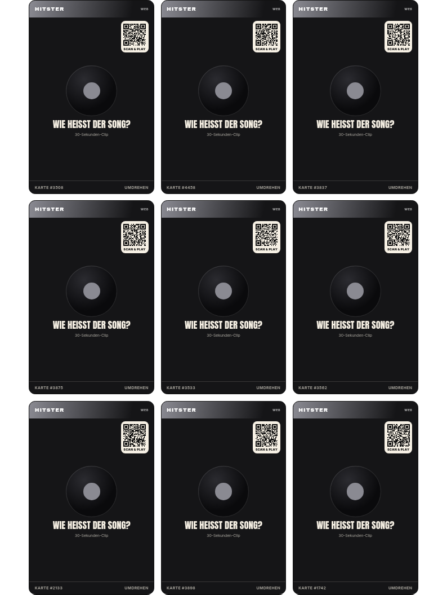

# HITSTER Web – Karten-Erweiterung

**Die kostenlose, werbefreie Karten-Erweiterung für Hitster – direkt im Browser.**
4.860 Songs · 30-Sekunden-Clips · echte Hitster-QR-Codes · Spotify-Playlists · eigene Kategorien · Online-Bingo · PWA · Karten zum Ausdrucken.
Kein Login, keine Werbung, kein externes Tracking. Open Source (MIT).


- **Live (GitHub Pages):** https://dealwirth.github.io/hitster-web/
- **Quellcode:** https://github.com/Dealwirth/hitster-web
- **Lokal:** `npm install && npm start` → http://localhost:12000

> Inoffizielles Fanprojekt. HITSTER ist eine Marke der Jumbo Group bzw. ihrer
> Rechteinhaber. Dieses Projekt ist nicht mit HITSTER verbunden.

## Was die App kann

- **Freies Spiel:** Zufällige Karte ziehen, 30-Sekunden-Clip hören, Jahr raten, umdrehen.
- **Karte bedienen:** Tippen/Klick dreht die Karte um, ohne die Musik zu stoppen. Wischen (oder `N`) zieht die nächste Karte und startet den Clip automatisch. Nur Play und Scan bleiben als Buttons.
- **Karten scannen:** **echten Hitster-QR-Code scannen** – kein Jahr eintippen. Die App erkennt Kartenset und das aufgedruckte Jahr, zieht aber ein **anderes Lied aus demselben Jahr** und spielt dessen Clip. Das Jahr bleibt vor dem Umdrehen unsichtbar.
- **Versionen:** Große Auswahl statt nur ein Genre – **Guilty Pleasures**, **Party & Dance**, **Rock & Metal**, **Deutsch**, **One-Hit-Wonder**, **Oldies**, **90s Party**, **Love & Heartbreak**, **Film & Musical**, **Summer Hits**, **Charts & Neu** und **Bangers**. Jede Version lässt sich mit Musikrichtung und Jahrzehnt weiter eingrenzen.
- **Kartenset wählen:** Original, Bingo, 100 % Deutsch, Rock, Schlager, Hip-Hop usw.
  Der QR-Code enthält Region, Set-Kürzel und Kartennummer (z. B. `de/aaaa0019/00052`); das Set wird automatisch erkannt.
- **QR-Scanner:** Kamera oder Foto auf die Rückseite halten – erkennt echte
  Hitster-URLs wie `hitstergame.com/de/00052`, `.../00128` oder `.../de/aaaa0019/00215` automatisch.
  Kein Link eintippen, kein Jahr ablesen. Zusätzlich werden Spotify-Track-Links,
  Jahreszahlen und die QR-Codes unserer gedruckten Karten erkannt.
- **Spotify-Playlist:** Link einfügen – **alle** Lieder der Playlist werden übernommen, nicht nur die ersten 50/100. Titel, Jahr, Vorschau und Cover kommen direkt von Spotify; kein Login/API-Key nötig.
- **Eigene Kategorien:** Jede geladene Playlist lässt sich lokal als eigene Kategorie speichern, wieder laden und löschen. Keine falschen Auto-Genres nötig.
- **Runde ohne Doppel:** Jede Karte kommt in einer Runde nur einmal. „Neue Runde“
  setzt Karten, Statistik und Fortschritt zurück.
- **Hitster-Optik:** Vorderseite neutral (kein Jahr, kein Genre, kein Titel), Rückseite
  mit großem Erscheinungsjahr, Songtitel, Interpret, Solo/Band-Icon und allen
  passenden Musik-/Bingo-Kategorien. Keine Bingo-Antworten, keine Werbung, keine Ablenkung.
- **Bekannte Songs:** 300 zusätzliche Chart-Hits aus iTunes-Charts, 63 kuratierte
  Klassiker, **181 neue Rock-/Metal-Songs** aus dem Songseeker-Rock-Deck und
  **36 Oldie-Ergänzungen**, damit jedes Jahr ab 1950 mindestens zehn Lieder hat.
- **Druckbogen:** 9 Karten pro A4-Seite, **kompakt 54 × 84 mm** oder klassisch
  **59 × 91 mm**, Vorder- und Rückseite, duplexfähig (lange Kante spiegeln).
  Vorderseite mit QR, Rückseite mit Auflösung und Kategorien.
- **Online-Bingo 1:1:** Host erstellt einen Raum, alle anderen treten per Link oder
  QR-Code bei – ohne Konto, ohne eigenen Server. Jeder hat eine echte 5×5-Farbkarte
  mit fünf Bingo-Kategorien, hört den Clip am eigenen Gerät und setzt bei richtiger
  Antwort ein Kreuz in der passenden Farbe. Es gibt **kein festes Rundenlimit**:
  Gespielt wird, bis jemand eine vollständige Reihe hat. Danach stimmt die Runde
  ab, ob es bis zum nächsten Bingo weitergeht. Die Songauswahl lässt sich vorher
  auf **Bekannt**, **Gemixt** oder **Unbekannt** stellen. Sobald alle getippt haben,
  wird automatisch aufgelöst; nach dem Kreuzen startet die nächste Runde ohne
  Host-Klick. Die Kreuzzeit ist hostseitig einstellbar (6/10/12/20 s); kurz vor
  Ablauf blinkt das Feld fünfmal, danach wird ein freies Feld zufällig gesetzt.
  Verbindung direkt zwischen den Geräten (WebRTC/PeerJS),
  gleicher Browser zusätzlich per BroadcastChannel. Bei blockiertem Autoplay
  erscheint ein großer „Ton aktivieren“-Button.
- **Datenbank:** Alle 4.860 Songs mit Jahr, Genre, Kategorien, Beliebtheit,
  Spotify-/Deezer-/iTunes-IDs und Versionen als JSON herunterladen (`/api/database`).
- **PWA:** Installierbar, offlinefähige Shell, Manifest, Icons, Service Worker.
- **Filter:** 8 Jahrzehnte, **21 Musikrichtungen mit Live-Trefferzahlen**, Bekanntheit
  (**Alle / Bekannt / Gemixt / Unbekannt**), Versionen, One-Hit-Wonder und „nur mit
  Spotify-Link“. Die Auswahl steht in der URL (`?genre=rock`, `?familiarity=known`,
  `?mode=versions&version=guilty`) und lässt sich zurücksetzen.
- **Lokale Nutzung:** Welche Versionen, Genres, Modi, Scans und Aktionen genutzt
  werden, wird ausschließlich im Browser gespeichert. Kein Konto, keine Übertragung;
  Export und Löschen sind im Hilfe-Dialog möglich.
- **Scan ohne Tippen:** Ein großer Sucher mit animiertem Rahmen zeigt sofort, ob
  die Kamera aktiv ist. Alternativ lässt sich ein Foto der Karte wählen. Die App
  erkennt Region, Kartennummer und Kartenset automatisch. Deep-Links wie
  `?hitster=de/00052` funktionieren weiterhin.

## Online-Bingo

1. Startseite → **Online-Bingo** → Raum erstellen.
2. Link oder QR-Code teilen. Alle anderen öffnen ihn und treten mit Namen bei.
3. Alle stimmen über **Version** und **Schwierigkeit** ab – Seite A (Einsteiger) oder Seite B (Expert).
4. Der Host startet. Die Discokugel wählt eine Kategorie, der Clip läuft für alle gleichzeitig.
5. Innerhalb der Antwortzeit tippen – bei Jahresfragen reichen zwei Ziffern
   (`84` = 1984, `06` = 2006). Sobald alle getippt haben, wird sofort aufgelöst.
6. Richtig? Kreuz auf ein freies Feld in der Kategoriefarbe. Dafür läuft die
   hostseitig eingestellte Kreuzzeit; kurz vor Schluss blinkt das Feld fünfmal,
   danach wird automatisch ein freies Feld zufällig gesetzt.
7. Wer zuerst fünf Felder waagerecht, senkrecht oder diagonal voll hat, ruft **BINGO**.
   Die nächste Runde startet automatisch – der Host muss nicht klicken.

Die Karte ist wie beim echten Hitster Bingo ein **5×5-Farbfeld**: jede Farbe steht
für eine Kategorie, jede Kategorie kommt genau fünfmal vor. Seite A: Solo/Gruppe,
Vor 2000, ±4 Jahre, Jahrzehnt, ±2 Jahre. Seite B: Songtitel, exaktes Jahr,
Interpret/Band, Jahrzehnt, ±3 Jahre. Kein Login, keine Werbung.

## So spielst du

### Freies Spiel
1. Karte ziehen (oder Filter setzen).
2. Clip abspielen und Jahr raten.
3. Karte umdrehen – Jahr, Titel und Interpret stehen auf der Rückseite.

### Mit einer echten Hitster-Karte
1. **Karte scannen** drücken – der Button ist immer sichtbar.
2. QR-Code der Originalkarte mit Kamera oder Foto scannen. Kein Jahr eintippen.
3. Die App erkennt das Set und das aufgedruckte Jahr und zieht ein **anderes** Lied aus demselben Jahr; der Clip läuft direkt.
4. Clip hören, im Zeitstrahl einsortieren, umdrehen, auflösen.

### Karten drucken
1. „Druckbogen erstellen“ öffnen.
2. 9, 18 oder 27 Karten wählen.
3. Beidseitig drucken, an der **langen Kante spiegeln**, ausschneiden.
4. Im Druckdialog **Hintergrundgrafiken** aktivieren, damit die Farben mitgedruckt werden.



## QR-Codes

| QR-Inhalt | Verhalten |
|---|---|
| `hitstergame.com/de/00008` | Echte Hitster-Karte: Set automatisch erkennen, Jahr intern übernehmen und ein anderes Lied aus demselben Jahr abspielen. |
| `hitstergame.com/de/aaaa0019/00215` | Echte Karte mit Set-Kürzel: Karte erkennen, anderes Lied aus 2007 abspielen. |
| `…/?card=s0042` | Öffnet genau diese Karte. |
| `1984` oder `…/?year=1984` | Interner Deep-Link: zieht ein Lied aus 1984. |
| `https://open.spotify.com/track/…` | Erkennt das Lied, ermittelt das Jahr und zieht ein anderes Lied aus diesem Jahr. |
| `https://open.spotify.com/playlist/…` | Lädt die Playlist als Kartenrunde. |
| `spotify:track:…` | Wie Spotify-Link. |
| Unbekannt | Jahr manuell eingeben. |

## Technik

- **Frontend:** Vanilla JS, CSS, keine Build-Pflicht, keine Frameworks.
- **Backend (lokal/Server):** Node.js + Express.
- `/api/catalog` – Katalog (gzip, 1 Tag cachebar)
  - `/api/song/:id` – eine Karte
  - `/api/audio/:id` – 30-Sekunden-Clip über Deezer/iTunes-Proxy (RAM-/Disk-Cache)
  - `/api/qr/:id` – QR-Code als SVG
  - `/api/art/:id` – Cover-Proxy mit Cache
  - `/api/resolve?spotify=…` – Spotify-Link → Titel/Künstler/Jahr (Katalog + Spotify-Metadaten)
  - `/api/spotify/track/:id` – Spotify-Embed-Metadaten + MusicBrainz-Erstveröffentlichung
- `/api/database` – komplette Song-/Kategorie-Datenbank als JSON-Download
- `/api/qr?text=…` – QR-Code für Online-Einladungen (SVG)
- `/api/playlist?url=…` – Spotify-Playlist → **alle** Karten mit Jahr, Vorschau und Cover
- **Daten:** `data/songs.source.tsv` (Quelle) → `data/catalog.json` (4.860 Songs, 1950–2026), ergänzt um Chart-Hits, kuratierte Klassiker, Songseeker-Rock/Metal, Oldie- sowie Soundtrack-/One-Hit-Ergänzungen.
- **Echte Kartendaten:** `public/hitster-cards.json` mit **51.208 Karten aus 18 Decks** (Titel, Interpret, Jahr, Solo/Band, Spotify-/YouTube-Link) aus [Songseeker](https://github.com/andygruber/songseeker-hitster-playlists) (MIT). Import: `npm run import:cards`. Die Kartenmetadaten dienen nur zur Jahres-/Set-Erkennung; gespielt wird ein anderes Lied aus demselben Jahr.
- **Statische Version:** `docs/` ist ein GitHub-Pages-Build. Sie nutzt `catalog.json`,
  `hitster-db.json`, `hitster-cards.json`, vorgenerierte QR-Codes und iTunes-Vorschauen direkt im Browser.
  Für Playlist/Spotify-Auflösung und Online-QR wird die Server-API über `PUBLIC_API_BASE` eingebunden
  (Standard: die Work-URL). Ohne API funktionieren Katalog, QR-Scan, Audio und Druck weiter;
  Online-Bingo nutzt PeerJS direkt zwischen den Geräten.
- **Nutzungsdaten:** `localStorage` unter `hitster-web-analytics-v1`, aggregiert nach
  Aktionen, Versionen, Genres, Modi, Jahrzehnten und Scans. Keine Serverübertragung.
- **PWA:** `public/manifest.webmanifest`, `public/sw.js`, Icons in `public/icons/`.

### Performance

- Katalog wird einmal aufbereitet und gzip ausgeliefert: **~1,6 MB roh / ~320 KB gzip**.
- Die exakte Karten-Datenbank (`hitster-cards.json`) ist **~2,0 MB roh / ~420 KB gzip**
  und wird nur beim ersten Scan geladen.
- `/api/catalog` ist **1 Tag** cachebar, versionierte CSS/JS-Dateien **1 Jahr**
  (`immutable`), Asset-Version `4.12.0`.
- Audio-Quellen werden **parallel** (Deezer/iTunes) aufgelöst, Timeouts 8–15 s.
- Cache-Hits brauchen keinen Verzeichnis-Scan.
- `scripts/serve-watchdog.sh` startet den Node-Prozess nach einem Absturz neu.

## Projektstruktur

```
.
├── public/                 Frontend (index.html, app.js, online.js, styles.css, fonts/, vendor/)
├── server/                 Express-API, Katalog, Audio-Proxy
├── data/                   songs.source.tsv, catalog.json, Caches
├── scripts/                Katalog-Erweiterung, Static-Build, Watchdog
├── docs/                   GitHub-Pages-Build + Screenshots
├── tests/                  Unit/API, E2E, A11y, Small-Viewport, Audio
└── README.md
```

## Entwicklung

```bash
npm install
npm start              # http://localhost:12000
npm test               # Unit- und API-Tests
npm run test:e2e       # Browser-E2E (Chromium, 33 Checks)
npm run test:v4        # Scan, Kartenset, Versionen, Playlist, PWA, Druck (Chromium)
npm run test:v5        # 51.208 Karten, Genre-Filter, anderes Lied aus demselben Jahr, 664-Track-Playlist
npm run test:online    # Startseite, Versionen, Datenbank, Playlist-Cache, Online-Bingo
npm run test:static    # GitHub-Pages-Build + lokale API (Chromium)
npm run test:a11y      # Barrierefreiheit
npm run test:small     # 320-px-Viewport
npm run test:audio     # echte Audio-Clips
npm run screenshots    # docs/screenshot-*.png
npm run add:years      # fehlende Jahre mit kuratierten Oldies auffüllen
```

### GitHub-Pages-Build

```bash
PUBLIC_API_BASE=https://dein-server.example npm run build:static
# schreibt docs/ (Katalog, hitster-db.json, QR-Codes, PWA-Assets)
```

GitHub Pages wird aus `main` / `/docs` veröffentlicht:
https://dealwirth.github.io/hitster-web/

### Server mit Auto-Restart

```bash
setsid ./scripts/serve-watchdog.sh >/dev/null 2>&1 < /dev/null &
```

Logs: `server.log`. Für Dauerbetrieb eignen sich auch systemd, PM2 oder Docker.

## Daten & Lizenz

- 4.860 Songs, 1950–2026, 21 Genres, 300 Chart-Hits, 63 kuratierte Klassiker, 181 Rock-/Metal-Ergänzungen, 36 Oldie-Ergänzungen für die Jahre 1950–1955 und 159 Soundtrack-/One-Hit-Erweiterungen. Jede Version hat mindestens 500 Karten; kleine Genres werden mit bekannten passenden Songs aufgefüllt.
- Song-Clips sind offizielle 30-Sekunden-Vorschauen von Deezer, Spotify bzw. iTunes.
- Jahres-Auflösung: kuratierter Katalog, sonst MusicBrainz-Erstveröffentlichung, sonst iTunes/Spotify.
- Echte Kartendaten: `public/hitster-db.json` (176 Spieldatenbanken, Karten → Spotify-ID + Gruppe/Solo) und `public/hitster-cards.json` (5.192 Karten mit exakten Songdaten).
- Kein Login, keine Werbung, kein externes Tracking. Online-Bingo verbindet die Geräte direkt per WebRTC/PeerJS; die lokale Nutzungsstatistik bleibt im Browser.
- Code: **MIT-Lizenz**. HITSTER-Marke und Originalkarten gehören den jeweiligen
  Rechteinhabern.
