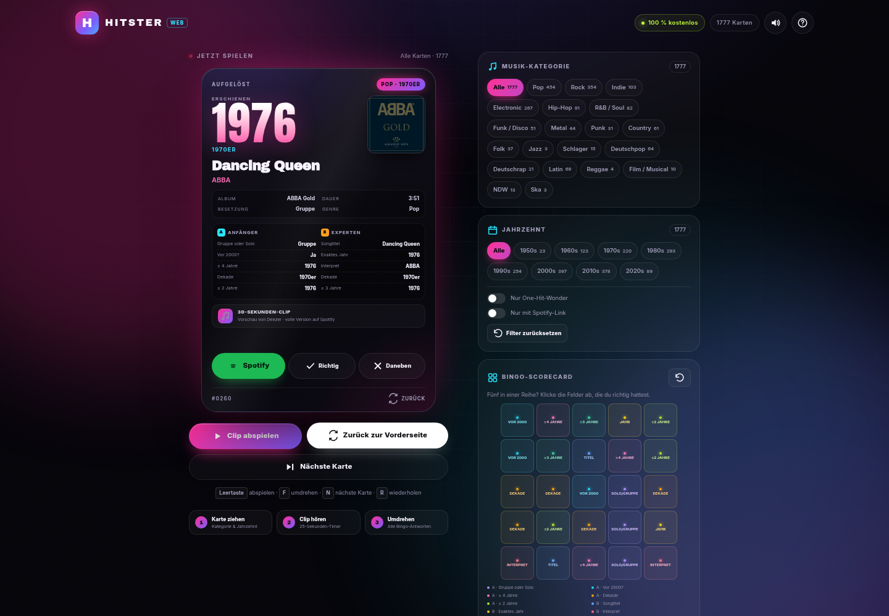

# HITSTER Web 🎧

**Das kostenlose Musik-Partyspiel im Hitster-Stil – direkt im Browser.**
Zufällige Karte ziehen, 30-Sekunden-Clip hören, umdrehen und das Jahr erraten.
Über **1.700 Songs**, **20 Musik-Kategorien**, **alle zehn Hitster-Bingo-Kategorien**,
Spotify-Links, kein Login, keine Werbung, kein Tracking.


---

## Was ist das?

Ein inoffizielles Open-Source-Fanprojekt für alle, die Hitster mögen, aber keine Karten
dabeihaben. Du bekommst eine zufällige Karte aus einer kuratierten Datenbank mit
**1.777 Songs von 1954 bis 2024**. Ein Klick startet einen offiziellen
30-Sekunden-Clip, ein 25-Sekunden-Timer läuft mit. Auf der Rückseite stehen
Titel, Interpret, Jahr, Album, Cover und **alle Antworten für die Hitster-Bingo-Kategorien**.
Zusätzlich öffnet ein Button den passenden Song auf Spotify.

### Features

- 🎲 **Zufällige Karten** aus 1.777 Songs, gefiltert nach Genre und Jahrzehnt
- 🎵 **30-Sekunden-Clips** über Deezer (Fallback: iTunes), serverseitig gecacht
- 🔄 **3D-Karten-Flip** mit Jahr, Titel, Interpret, Album-Cover und Metadaten
- 🎯 **Alle 10 Hitster-Bingo-Kategorien** auf jeder Karte:
  - **A – Anfänger:** Gruppe/Solo, Vor 2000?, ±4 Jahre, Dekade, ±2 Jahre
  - **B – Experten:** Songtitel, exaktes Jahr, Interpret, Dekade, ±3 Jahre
- 🟩 **5×5-Bingo-Scorecard** zum Abhaken (wird lokal gespeichert)
- 🎨 **20 Musik-Kategorien:** Pop, Rock, Indie, Electronic, Hip-Hop, R&B/Soul,
  Funk/Disco, Metal, Punk, Country, Folk, Jazz, Schlager, Deutschpop, Deutschrap,
  Latin, Reggae, Film/Musical, NDW, Ska
- 📅 **8 Jahrzehnte:** 1950er bis 2020er
- 🔥 **One-Hit-Wonder-Filter** und **Nur-mit-Spotify**-Filter
- 🟢 **Spotify-Player** als eingebettetes iframe (lädt nur auf Klick)
- 📊 **Lokale Statistik:** Karten, richtige Antworten, Quote, Serie – ohne Login
- ⌨️ **Tastatur:** Leertaste (Play/Pause), F (umdrehen), N (nächste), R (wiederholen), ? (Hilfe)
- 📱 **Responsive** für Handy, Tablet und Desktop
- ♿ **Barrierefrei** geprüft (axe-core: 0 Verstöße auf Vorder- und Rückseite)
- 🔒 **Kein Login, keine Werbung, kein Tracking, keine Cookies**
- 🧩 **Vanilla JS + Express** – kein Build-Schritt für das Frontend, leicht zu hosten



---

## Schnellstart

Voraussetzung: **Node.js 20+** (getestet mit Node 24).

```bash
npm install
npm start
```

Dann öffnen: **http://localhost:12000**

Anderer Port:

```bash
PORT=8080 npm start
```

Das Frontend liegt in `public/` und braucht keinen Build. Der Server liefert
Statics, Katalog-API, Audio-Proxy und Cover-Cache aus.

---

## Spielen

1. **Karte ziehen.** Wähle rechts eine Musik-Kategorie und ein Jahrzehnt – oder lass
   alles auf Zufall.
2. **Clip hören.** Tippe auf die Karte oder auf „Clip abspielen“. Der Clip läuft,
   der 25-Sekunden-Timer zählt herunter.
3. **Raten.** Titel, Interpret, Jahr – auf der Vorderseite stehen alle zehn
   Bingo-Kategorien als Erinnerung.
4. **Umdrehen.** Mit „Karte umdrehen“, `F` oder einem Klick auf die Karte.
   Die Rückseite zeigt die Auflösung und alle Bingo-Antworten.
5. **Bewerten.** „Richtig“ oder „Daneben“ aktualisiert deine Serie und Quote.
6. **Bingo!** Markiere richtige Felder auf der 5×5-Scorecard. Fünf in einer Reihe
   (waagerecht, senkrecht oder diagonal) = **HITSTER!**

> Tipp: Die Filter zählen live mit. „Klassik“ wird nur angezeigt, wenn es Karten gibt.
> Der Zufall vermeidet Wiederholungen der letzten 80 Karten.

---

## Musik-Kategorien

| Kategorie | Songs | Kategorie | Songs |
|---|---:|---|---:|
| Pop | 454 | Rock | 354 |
| Electronic | 267 | Indie | 103 |
| Hip-Hop | 91 | R&B / Soul | 82 |
| Latin | 69 | Deutschpop | 64 |
| Country | 61 | Funk / Disco | 51 |
| Metal | 44 | Folk | 37 |
| Punk | 31 | Deutschrap | 21 |
| Schlager | 15 | NDW | 13 |
| Film / Musical | 10 | Reggae | 4 |
| Jazz | 3 | Ska | 3 |

*(Stand: automatisch aus `data/catalog.json` generiert; die Zahlen können nach
einem Rebuild leicht abweichen.)*

---

## Technik

```
.
├── server/
│   ├── index.js        Express-App, API, Security-Header, Static-Server
│   ├── catalog.js      Katalog laden, filtern, Zufall, Bingo-Antworten
│   └── audio.js        Deezer/iTunes-Auflösung, Audio-Cache, Range-Support, Cover-Cache
├── public/
│   ├── index.html      Semantische Single-Page-Struktur
│   ├── styles.css      Design-System, Karten-Flip, Responsive, Reduced Motion
│   ├── app.js          Spiel-Logik, Audio, Timer, Bingo, Filter, Statistik
│   └── fonts/          Selbst gehostete Schriften (Archivo Black, Anton, Inter)
├── scripts/
│   └── build-catalog.js  TSV → JSON, Deezer/iTunes-Matching, Spotify-IDs
├── data/
│   ├── songs.source.tsv  Kuratierte Quelle (Jahr | Genre | G/S | Interpret | Titel | Tags)
│   ├── catalog.json      Generierter Katalog (1.777 Songs)
│   └── build-report.json Build-Report (Trefferquote, fehlende Songs)
├── tests/
│   ├── catalog.test.js   Datenqualität (node:test)
│   ├── api.test.js       API-Integration (node:test + supertest)
│   ├── e2e.test.js       Browser-E2E (Playwright + Chromium)
│   ├── a11y.mjs          axe-core-Audit
│   ├── sample-audio.mjs  Stichprobe echter Audio-Clips
│   ├── fallback-audio.mjs iTunes/m4a-Fallback prüfen
│   ├── small-viewport.mjs 320-px-Viewport prüfen
│   ├── range.test.js     Range-Parser (Unit)
│   └── screenshots.mjs   Screenshots für die Docs
└── docs/                 Screenshots
```

### Datenpipeline

`data/songs.source.tsv` ist die einzige Quelle für neue Songs. Eine Zeile sieht so aus:

```
1976|pop|G|ABBA|Dancing Queen|
2004|rock|G|Green Day|Boulevard of Broken Dreams|
2009|pop|S|Lady Gaga|Poker Face|
```

Felder: `Jahr | Genre | G/S | Interpret | Titel | Tags`
- `G` = Gruppe/Duo/Feature, `S` = Solo
- Tags (optional, kommagetrennt): z. B. `onehit`, `cover`
- Erlaubte Genres: `pop, rock, indie, electronic, hiphop, rnb, funk, metal, punk,
  country, folk, jazz, schlager, deutschpop, deutschrap, latin, reggae, film,
  klassik, ndw, ska`

Danach:

```bash
npm run build:catalog
```

Das Skript sucht für jeden Song über die **Deezer-API** einen 30-Sekunden-Clip
und ein Cover, fällt bei Bedarf auf die **iTunes Search API** zurück und ergänzt
– wenn möglich – eine **Spotify-Track-ID** aus einem offenen Datensatz.
Ergebnisse werden in `data/.cache/resolved.json` zwischengespeichert; ein
abgebrochener Lauf kann fortgesetzt werden (`--force` ignoriert den Cache,
`--limit=N` verarbeitet nur N offene Songs).

### Audio-Proxy

Der Browser lädt nie direkt von Deezer/iTunes, sondern immer über
`/api/audio/:id`. Der Server:

1. löst bei Bedarf eine frische, signierte Preview-URL auf (Deezer-URLs laufen ab),
2. lädt den Clip einmal herunter und cached ihn unter `data/.cache/audio/`,
3. liefert ihn mit `Accept-Ranges`/`206` aus (Seeking funktioniert),
4. hält maximal 30 Clips im RAM und pruned den Disk-Cache bei 800 MB.

Cover laufen analog über `/api/art/:id` und werden unter `data/.cache/art/` gecacht.
Beide Caches sind in `.gitignore` und nicht Teil des Repos.

### Spotify

- 1.250 der 1.777 Songs haben eine direkte Spotify-Track-ID.
- Der grüne Button öffnet ein Modal mit dem offiziellen Spotify-Embed-Player.
- Ohne Login spielt Spotify in der Regel eine Vorschau; für den vollen Song
  ist ein Spotify-Konto nötig. Der Button „In Spotify öffnen“ führt zur App.
- Für Songs ohne ID öffnet der Button die Spotify-Suche.
- Es werden **keine Spotify-API-Zugangsdaten** benötigt.

---

## Tests

```bash
npm test            # 26 Unit- und API-Tests (Katalog, Filter, Audio, Range, Security)
npm run test:e2e    # 24 Browser-Checks mit Chromium (Desktop + Mobile)
```

Zusätzlich (Server muss auf Port 12000 laufen):

```bash
npm run test:a11y    # axe-core: WCAG 2.0/2.1 A/AA (0 Verstöße)
npm run test:audio   # 36 zufällige Clips + alle iTunes/m4a-Fallbacks abspielen
npm run test:small   # 320-px-Viewport: kein Overflow, Karte passt, Flip funktioniert
npm run screenshots  # Screenshots nach docs/
```

Die E2E-Tests prüfen u. a.:

- Katalog lädt, 10 Bingo-Kategorien, 5+5 Antworten, 25 Scorecard-Felder
- kein Audio-Download vor dem ersten Klick
- echter Audio-Clip startet (`currentTime > 0`, Dauer ~30 s)
- Timer zählt herunter
- Flip zeigt Titel/Interpret/Jahr, Cover lädt
- „Richtig“ aktualisiert Statistik und Confetti
- Bingo-Feld wird markiert und in `localStorage` gespeichert
- Hilfe- und Spotify-Modal, Escape schließt
- Filter (Genre + Jahrzehnt), URL-Parameter, Reset
- Tastatur-Shortcuts
- Mobile: kein horizontaler Overflow, Karte passt, Tap spielt, Filter funktionieren
- keine Runtime-Fehler

`npm run test:e2e` erwartet Chromium unter `/usr/bin/chromium`.
Alternativ: `CHROMIUM_PATH=/pfad/zu/chromium npm run test:e2e`.

---

## Datenschutz & Recht

- **Kein Login, keine Werbung, kein Tracking.** Es werden keine Analyse-Skripte
  geladen. Statistiken und die Bingo-Scorecard liegen ausschließlich in
  `localStorage` deines Browsers.
- **Audio:** Es werden offizielle 30-Sekunden-Vorschauen von Deezer bzw. iTunes
  gestreamt. Die Rechte an Musik, Covern und Marken liegen bei den jeweiligen
  Künstler:innen, Labels und Rechteinhabern. Dieses Projekt hostet keine Musik.
- **Spotify** wird nur auf ausdrücklichen Klick als iframe geladen.
- **HITSTER** ist eine Marke der Jumbo Group bzw. ihrer Rechteinhaber. Dieses
  Projekt ist **nicht** mit HITSTER verbunden, wird nicht von Jumbo unterstützt
  und dient nur dem privaten Spaß.
- Der Quellcode steht unter der **MIT-Lizenz** (siehe [LICENSE](LICENSE)).
  Die Lizenz gilt für den Code, nicht für die gestreamten Inhalte Dritter.

---

## Deployment

Der Server ist eine normale Node-App ohne Datenbank:

```bash
PORT=12000 npm start
```

Empfohlen: hinter einem Reverse Proxy (Caddy/Nginx) mit HTTPS betreiben.
Die App bindet an `0.0.0.0`. Für einen dauerhaften Betrieb z. B. systemd,
PM2 oder Docker verwenden. Der Audio-Cache wächst nur bis 800 MB und wird
automatisch geprüft/gepruned.

**Docker (Beispiel):**

```dockerfile
FROM node:24-alpine
WORKDIR /app
COPY package*.json ./
RUN npm ci --omit=dev
COPY . .
ENV PORT=12000
EXPOSE 12000
CMD ["npm", "start"]
```

```bash
docker build -t hitster-web .
docker run -p 12000:12000 hitster-web
```

---

## Mitmachen

Neue Songs? Einfach eine Zeile in `data/songs.source.tsv` ergänzen und
`npm run build:catalog` laufen lassen. Bitte nur Songs mit korrektem
**Erscheinungsjahr** (Jahr der Veröffentlichung bzw. ersten öffentlichen
Aufführung) eintragen. Pull Requests willkommen.

## Lizenz

[MIT](LICENSE) © HITSTER Web contributors

Viel Spaß beim Raten! 🎶
